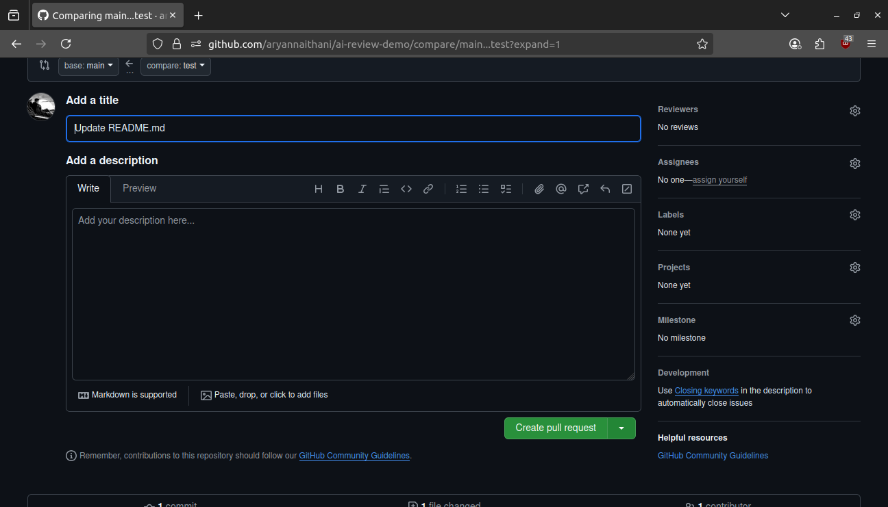
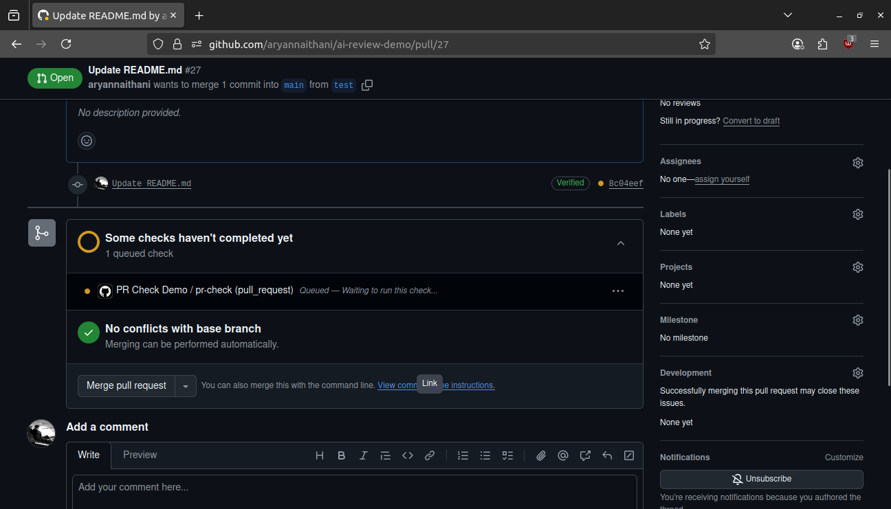
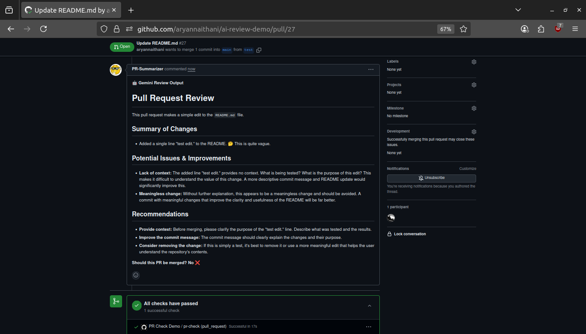

# AI Code Review GitHub Action

AI Code Review Action is a GitHub Action that automatically analyzes pull requests and generates structured code review feedback using a large language model.

The action runs during pull request events, inspects the code diff, and posts a formatted review comment highlighting potential issues, improvement suggestions, and an overall merge readiness assessment.

The goal is to reduce manual review overhead while maintaining code quality and consistency across repositories.

---

## Key Features

- Automated AI-assisted review on pull requests
- Diff-aware analysis of changed files
- Suggestions for readability, maintainability, and potential bugs
- Merge-readiness evaluation
- Simple integration into any GitHub repository
- Runs entirely inside GitHub Actions CI

---

## How It Works

When a pull request is opened or updated:

1. GitHub Actions triggers the workflow.
2. The action retrieves the pull request diff using the GitHub API.
3. The diff is sent to the LLM (Gemini) for analysis.
4. The model generates a structured review containing:
   - Observed issues
   - Suggested improvements
   - Code quality observations
   - Merge readiness signal
5. The action posts the review as a comment on the pull request.

This creates a fast feedback loop before human reviewers step in.

---

## Architecture

```
Pull Request Event
        │
        ▼
GitHub Actions Workflow
        │
        ▼
Python Review Script
        │
        ├── Fetch PR diff (GitHub API)
        │
        ├── Send diff to Gemini model
        │
        ▼
Structured Review Generated
        │
        ▼
Comment posted on Pull Request
```

---

## Example Workflow

### Step 1 – Developer submits a pull request



### Step 2 – GitHub Action runs automatically



### Step 3 – AI review is posted in PR comments



---

## Setup

### 1. Add the Workflow

Copy the workflow file into your repository:

```
.github/workflows/action.yml
```

### 2. Add the Review Script

Copy the Python script:

```
scripts/main.py
```

### 3. Configure API Key

Create a GitHub Actions secret:

```
GEMINI_API_KEY
```

Steps:

1. Go to **Repository Settings**
2. Open **Secrets and Variables → Actions**
3. Add new secret `GEMINI_API_KEY`
4. Paste your Gemini API key

You can generate a key here:

https://aistudio.google.com/app/apikey

### 4. Open a Pull Request

Once configured, every new pull request will automatically trigger the action and generate an AI review comment.

---

## Example Review Output

The action produces a structured comment that may include:

- Code readability issues
- Possible logical errors
- Suggestions for refactoring
- Security or best-practice warnings
- Overall merge readiness signal

This provides immediate automated feedback before manual review.

---

## Limitations

- Large diffs may exceed LLM context limits.
- Model suggestions should be reviewed by humans before merging.
- Requires an external LLM API key.

---

## Future Improvements

- Inline code comments instead of a single PR comment
- File-level review summaries
- Static analysis integration (linting + AI reasoning)
- Support for additional LLM providers

---

## Contributing

Contributions are welcome.  
Feel free to open issues or pull requests to improve the action.
